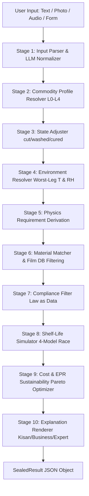

# 🎙 Aavaran AI (आवरण)

[](https://github.com/immortalfoodie/Aavaran-AI/actions/workflows/ci.yml)
[](https://www.python.org/)
[](https://fastapi.tiangolo.com/)
[](https://react.dev/)
[](https://tailwindcss.com/)
[](LICENSE)
[-brightgreen.svg)](docs/ACCURACY.md)
[](#6-compliance-engine--law-as-data)

> **A voice-first food packaging advisor for Indian farmers and small food businesses.**
> Speak in any of 10 Indian languages, including Hinglish. **Aavaran Saathi** listens with **Gnani AI Prisma** (speech-to-text),
> asks only for what is missing, runs its deterministic physics + law engine, and answers out loud with
> **Gnani AI Timbre** (text-to-speech), including saying *"this is not a packaging problem"* when packaging can't make food safe.

```
 Farmer / vendor speaks ──► Gnani Prisma v3.0 (STT, KB-biased keyterms) ──► Saathi slot filling
        ▲                                                                       │  asks ONE missing thing
        │                                                                       ▼
 Gnani Timbre (TTS) ◄── spoken answer built only from engine numbers ◄── Aavaran AI engine (physics + FSSAI/EPR)
```

| | |
| :-- | :-- |
| **Gnani models used** | Prisma v3.0 STT (`POST /stt/v3`), Timbre v3.0 TTS (`POST /api/v1/tts/inference`), Timbre v2.5 `hi-en` voice for Hinglish |
| **Where** | [`api/voice/`](api/voice) (client, dialogue, keyterms, spoken-number normaliser), [`api/routes/voice.py`](api/routes/voice.py), [`web/src/voice/`](web/src/voice) |
| **Users** | Farmers, FPOs and mandi traders (Farmer tab); kirana shops and small food makers repacking atta, dal, namkeen, spices (Shop tab) |
| **Try it** | **[🌐 Live app](https://aavaran-ai-final.vercel.app/)** · **[▶ Demo video](https://youtu.be/mdLuSGNFSLk)** |
| **Details** | **[📄 1-page pitch](docs/PITCH.md)** · [docs/GNANI_INTEGRATION.md](docs/GNANI_INTEGRATION.md) · [docs/SUBMISSION.md](docs/SUBMISSION.md) |

### What it does

| | |
| :-- | :-- |
| 🎙 **Speak, don't type** | Saathi asks one short question at a time and answers out loud. Hands-free mode listens again after every answer. |
| 🌐 **10 languages** | Hindi, Marathi, English, Hinglish, Tamil, Telugu, Kannada, Gujarati, Punjabi, Bengali (the last six still need native-speaker review) |
| 🥬 **20 foods** | Potato, onion, tomato, banana, mango, okra, spinach, green chilli, guava, cauliflower, cabbage, grapes, pomegranate, brinjal · namkeen, milk powder, paneer, turmeric, wheat atta, toor dal |
| ⚠️ **Honest refusals** | "This is not a packaging problem" for cut produce in the heat or paneer outside the fridge, plus chilling-injury warnings (e.g. brinjal below 10 °C) |
| 💡 **Low-cost options** | Zero-energy cool chamber, ventilated onion store, crates, clay-pot cooler and more, each with ₹ cost and days gained from 29 cited sources ([kb/low_cost_storage.json](kb/low_cost_storage.json)) |
| 📈 **Sell today or store?** | Today's mandi price (Agmarknet via data.gov.in) for the farmer's district, falling back to the state, plus how many days holding is realistic. No price forecasting. |
| 🏪 **Kirana and small food makers** | Pack size and shelf-life target in, pouch options with ₹ per pack out |

### Setup

Backend environment (see [.env.example](.env.example)):

- `GNANI_API_KEY`: Gnani speech. Without it, Saathi uses typed input and the browser's voice.
- `DATA_GOV_IN_API_KEY`: mandi prices. This is the free personal key from data.gov.in (My Account → API key); one key works for every dataset. Without it, the price panel hides itself.

### Known limits (read before demoing)

- **Dry goods shelf life** (namkeen, milk powder, turmeric, atta, dal) comes from a film-class lookup in
  `engine/matcher/score.py`, not from the physics models. It currently lands inside or near the sourced ranges, and it is conservative for milk powder.
  The moisture model is ready to replace it, but the oxidation model's oxygen budget is not yet sourced.
- The golden benchmark's refusal cases call the safety gates directly; its viable cases pass the literature target
  into the matcher. Treat the headline accuracy as a regression check, not an independent validation.
- The engine does not model chilling injury or insect infestation in its shelf-life numbers. Chilling is surfaced as a warning only.

---

## Engine documentation

> **An AI & First-Principles Physics Food Packaging Decision Support System**  
> *Turning sparse, real-world inputs into regulation-checked, cost-optimized, shelf-life verified packaging specifications — with the courage to refuse when packaging is not the answer.*


---

## 📑 Table of Contents

- [1. Executive Overview](#1-executive-overview)
  - [The Problem in Numbers](#the-problem-in-numbers)
  - [Why Standard ML Classifiers Fail](#why-standard-ml-classifiers-fail)
  - [The Aavaran AI Architecture (Resolve → Decide → Explain)](#the-aavaran-ai-architecture-resolve--decide--explain)
- [2. "Refusal as a Safety Feature"](#2-refusal-as-a-safety-feature)
- [3. Three User Modes, One Unified Engine](#3-three-user-modes-one-unified-engine)
  - [🌾 Kisan Mode](#-kisan-mode)
  - [🏢 Business Mode](#-business-mode)
  - [🔬 Expert Mode](#-expert-mode)
- [4. The Physics & Mathematics Core](#4-the-physics--mathematics-core)
  - [4.1 Moisture Sorption (Labuza & GAB Isotherms)](#41-moisture-sorption-labuza--gab-isotherms)
  - [4.2 Lipid & Nutrient Oxidation (Oxygen Budgeting)](#42-lipid--nutrient-oxidation-oxygen-budgeting)
  - [4.3 Respiration & Modified Atmosphere Packaging (MAP)](#43-respiration--modified-atmosphere-packaging-map)
  - [4.4 Micro-Perforation Laser Hole Sizing](#44-micro-perforation-laser-hole-sizing)
  - [4.5 Microbial Growth & Pathogen Interlocks](#45-microbial-growth--pathogen-interlocks)
- [5. System Architecture & 10-Stage Pipeline](#5-system-architecture--10-stage-pipeline)
- [6. Compliance Engine — Law as Data](#6-compliance-engine--law-as-data)
  - [Indian Regulatory Envelope (FSSAI, BIS, PWM-EPR)](#indian-regulatory-envelope-fssai-bis-pwm-epr)
  - [Export Compliance (EU 10/2011, US FDA 21 CFR)](#export-compliance-eu-102011-us-fda-21-cfr)
- [7. Provenance, Trust & The Sealed Result Object](#7-provenance-trust--the-sealed-result-object)
- [8. Cryptographic Batch Traceability & Merkle Trees](#8-cryptographic-batch-traceability--merkle-trees)
- [9. Accuracy & Scientific Validation (64-Case Golden Benchmark)](#9-accuracy--scientific-validation-64-case-golden-benchmark)
- [10. Repository Layout](#10-repository-layout)
- [11. Quick Start & Developer Guide](#11-quick-start--developer-guide)
- [12. API Reference](#12-api-reference)
- [13. Neo-Brutalist Design System](#13-neo-brutalist-design-system)
- [14. Disclaimer & Citations](#14-disclaimer--citations)

---

## 1. Executive Overview

### The Problem in Numbers
Post-harvest food losses in India and developing agricultural economies represent an immense economic and nutritional drain:
- **6.0% – 15.1%** average post-harvest loss in fruits *(NABCONS 2022 / MoFPI)*.
- **4.9% – 11.6%** average post-harvest loss in vegetables.
- **₹1,52,790 Crore (~$18.5 Billion USD)** annual economic loss across agricultural commodities.
- **15.05%** loss in guava alone — India's worst-hit fruit crop.

*Sources: MoFPI / NABCONS "Study to Determine Post-Harvest Losses of Agri Produce in India" (2022); ICAR-CIPHET.*

### Why Standard ML Classifiers Fail
Most attempts to solve food packaging with machine learning feed food properties into a classifier to predict a packaging material. **This approach fundamentally fails in production**:
1. **No Ground Truth Dataset:** There is no massive, clean dataset of `"food properties → correct commercial packaging"` — an unconstrained neural network simply memorizes flawed supplier spreadsheets.
2. **Physics & Law Govern Packaging:** Moisture permeation, gas diffusion, microbial kinetics, respiration, and food safety laws (FSSAI, BIS, EU, US FDA) are deterministic and exact. Approximating them with neural nets discards precision and introduces dangerous hallucinations.
3. **The Sparse-Input Reality:** A smallholder farmer in Maharashtra or a mandi trader cannot supply laboratory parameters like water activity ($a_w$), respiration rate ($R_{CO_2}$), or critical moisture content.

### The Aavaran AI Architecture (Resolve → Decide → Explain)

Aavaran AI reverses the paradigm:
```
                      ┌─────────────────────────────────┐
                      │ 1. RESOLVE (AI + Hierarchies)   │
                      │ Translates messy text/photos    │
                      │ into complete physical vectors  │
                      └────────────────┬────────────────┘
                                       │
                                       ▼
                      ┌─────────────────────────────────┐
                      │ 2. DECIDE (Pure Physics & Law)  │
                      │ Deterministic mass balance,     │
                      │ Arrhenius respiration, rulesets │
                      └────────────────┬────────────────┘
                                       │
                                       ▼
                      ┌─────────────────────────────────┐
                      │ 3. EXPLAIN (Adaptive Synthesis) │
                      │ One sealed result rendered for  │
                      │ Kisan, Business, or Expert mode │
                      └─────────────────────────────────┘
```

- **Resolve:** Turns sparse prompts (e.g., *"aloo kaata hua do din pehle"* or a photo of bruised tomatoes) into complete parameter sets via an L0–L4 hierarchical fallback ladder with explicit uncertainty bands on every estimated property.
- **Decide:** Solves barrier targets (WVTR, OTR) from first principles, filters by statutory regulations, and ranks structures on cost, shelf life, and recyclability. **100% deterministic, auditable, and unit-tested.**
- **Explain:** Renders the identical sealed result object three ways: a visual action card for farmers, an RFQ and cost optimization sheet for food businesses, and a full mathematical model dump for packaging researchers.

---

## 2. "Refusal as a Safety Feature"

The most important engineering rule in Aavaran AI is: **The system must be allowed to say *"Packaging will not save this."***

### The Mumbai Cut Potato Dilemma
Consider cut potato sitting for two days in ambient Mumbai heat ($30^\circ\text{C}$, $80\%\text{ RH}$):
- A moisture-barrier film traps condensation, accelerating soft rot and microbial decay.
- An airtight seal creates an anaerobic environment at abuse temperatures ($>5^\circ\text{C}$), generating an immediate lethal hazard of **_Clostridium botulinum_** toxin formation.
- Enzymatic browning occurs within 1–3 hours.

A tool that unconditionally emits a plastic film recommendation is a tool that will poison consumers. Aavaran AI detects these non-viable conditions, enforces a **Hard Safety Block**, and outputs clear forward-looking operational advice:

```
┌────────────────────────────────────────────────────────────────────────┐
│ ⚠ CRITICAL SAFETY BLOCK: NOT A PACKAGING PROBLEM                       │
├────────────────────────────────────────────────────────────────────────┤
│ Cut potato stored for 2 days at ambient temperature is unsafe to sell. │
│ No bag, film, or wrap can reverse microbial proliferation.             │
│                                                                        │
│ CORRECTIVE ACTION FOR NEXT CYCLE:                                      │
│ • Do not cut produce until point-of-sale (cutting destroys 99% life).  │
│ • Dip freshly cut potato in cold lemon-salt water (citric acid wash).  │
│ • Maintain unbroken cold chain (≤ 5 °C) with anti-fog perforated bag.  │
│ • Never hermetically seal respiring cut produce at room temperature!   │
└────────────────────────────────────────────────────────────────────────┘
```

---

## 3. Three User Modes, One Unified Engine

Aavaran AI does not build separate apps for different users. All views consume the exact same underlying `SealedResult` JSON schema.

| Feature / Dimension | 🌾 Kisan Mode | 🏢 Business Mode | 🔬 Expert Mode |
| :--- | :--- | :--- | :--- |
| **Target Audience** | Farmers, Mandi Traders, FPOs | Food Startups, MSMEs, D2C Brands | Packaging Engineers, Scientists, QA |
| **Input Complexity** | 2–3 taps, photo upload, local voice | Batch size, shelf-life target, pack size | Full direct parameter overrides |
| **Output Format** | High-contrast visual card, audio | 3 ranked laminate specs + RFQ doc | Full model dump, sensitivity tornado |
| **Shelf-Life Display** | *"Keeps ~4 days. Sell within 5."* | *"4.2 d P50 (3.1–5.4 d P10–P90)"* | Monte Carlo curves, failure race |
| **Compliance Display** | One red line if illegal | Checklist for FSSAI category & EPR | Full rule trace with clause citations |
| **Cost & Economics** | *"₹38 crate saves ₹210 produce"* | ₹/pack, ₹/kg protected, EPR liability | Multi-objective Pareto frontier |
| **Traceability** | QR scan link for mandi buyer | Printable packaging label + QR code | Cryptographic Merkle chain proof |

### 🌾 Kisan Mode
- **Zero-Friction UI:** Massive buttons, high contrast, zero technical jargon.
- **Native Vernacular:** Phrased using mandi terms (*"hawa aane wali thaili"*, not *"sacchidra micro-perforated film"*).
- **Offline First:** Cached locally in IndexedDB; functions in deep rural areas without cellular signal.

### 🏢 Business Mode
- **Three Ranked Structures:** E.g., Option 1 (Gold standard high barrier), Option 2 (Cost-effective mono-material recyclable PP), Option 3 (Maximum shelf-life foil laminate).
- **Direct RFQ Generator:** Generates commercial, standards-referenced **Request for Quotation (RFQ)** documents that small brands can email directly to converters (e.g., Uflex, Cosmo, Jindal).
- **PWM-EPR Liability Calculator:** Computes exact Indian Plastic Waste Management Extended Producer Responsibility obligations in ₹/tonne.

### 🔬 Expert Mode
- **Interactive Assumption Ledger:** Direct inspection of every intermediate value, GAB isotherm constant, and Arrhenius activation energy ($E_a$).
- **Sensitivity Tornado:** Value-of-Information (VOI) analysis identifying which parameter would most drastically reduce prediction variance if measured in a laboratory.
- **Comprehensive Audit Trail:** Printable and verifiable PDF audit report citing ASTM, ISO, and IS test standards.

---

## 4. The Physics & Mathematics Core

Aavaran AI runs four deterministic failure-mode models in parallel. The shortest time to failure defines the shelf-life limit and names the primary spoilage mechanism. Every calculation applies a **documented 0.75 safety factor** (`SAFETY_FACTOR_SHELF_LIFE`).

```
                              ┌───────────────────────────────────┐
                              │     Candidate Food & Package      │
                              └─────────────────┬─────────────────┘
                                                │
         ┌──────────────────┬───────────────────┼───────────────────┬──────────────────┐
         ▼                  ▼                   ▼                   ▼                  ▼
┌─────────────────┐┌─────────────────┐┌───────────────────┐┌─────────────────┐┌─────────────────┐
│ Moisture Model  ││ Oxidation Model ││ Respiration Model ││ Microbial Model ││ Safety Gate     │
│ (Labuza / GAB)  ││ (Oxygen Budget) ││ (Arrhenius / MAP) ││ (Ratkowsky Sqrt)││ (Pathogen Floor)│
└────────┬────────┘└────────┬────────┘└─────────┬─────────┘└────────┬────────┘└────────┬────────┘
         │                  │                   │                   │                  │
         └──────────────────┴─────────┬─────────┴───────────────────┴──────────────────┘
                                      ▼
                        ┌───────────────────────────┐
                        │   Failure Mode Race       │
                        │   t = min(t_moist,        │
                        │           t_ox,           │
                        │           t_resp,         │
                        │           t_microb) * 0.75│
                        └───────────────────────────┘
```

### 4.1 Moisture Sorption (Labuza & GAB Isotherms)
For dry foods (biscuits, powders, spices, fried snacks), shelf life is governed by moisture uptake through the package barrier until the food reaches its critical water activity $a_{w,c}$.

The steady-state moisture flux is:
$$\frac{dm}{dt} = \frac{\text{WVTR}_{\text{film}}}{\Delta p_{\text{test}}} \cdot A \cdot (p_{\text{out}} - p_{\text{in}})$$

For linear sorption isotherms ($m = b \cdot a_w + c$):
$$\ln\left[ \frac{m_e - m_i}{m_e - m_c} \right] = \left(\frac{k}{x}\right) \cdot \left(\frac{A}{W_s}\right) \cdot \left(\frac{p_0}{b}\right) \cdot t$$

Solving for the **maximum allowable permeance** (the engineering design spec):
$$\text{Permeance}_{\max} = \frac{W_s \cdot b}{A \cdot p_0 \cdot t} \cdot \ln\left[ \frac{m_e - m_i}{m_e - m_c} \right]$$

*For foods with $a_{w,c} > 0.5$, the engine automatically transitions to the Guggenheim-Anderson-de Boer (GAB) isotherm equation to eliminate non-linear under-prediction.*

### 4.2 Lipid & Nutrient Oxidation (Oxygen Budgeting)
For fats, nuts, milk powders, and namkeen, the product possesses an **Oxygen Budget** ($Q_{\text{budget}}$, mg $\text{O}_2$/kg product) before sensory rancidity or peroxide thresholds are crossed:
$$\text{OTR}_{\max} = \frac{Q_{\text{budget}} \cdot M_{\text{product}} - \text{O}_{2,\text{headspace}}}{1.43 \cdot A \cdot \Delta p \cdot t}$$
*Aavaran AI models the vital impact of nitrogen flushing ($\text{N}_2$), showing startups how reducing headspace $\text{O}_2$ from 21% to 1% frequently saves more money than upgrading to an expensive foil barrier.*

### 4.3 Respiration & Modified Atmosphere Packaging (MAP)
At equilibrium in fresh produce packaging, gas ingress through the barrier equals respiratory consumption:
$$\text{OTR}_{\text{req}} = \frac{R_{\text{O}_2} \cdot M \cdot 24}{A \cdot (y_{\text{out}} - y_{\text{in}})}$$
$$\text{CO}_{2}\text{TR}_{\text{req}} = \frac{R_{\text{CO}_2} \cdot M \cdot 24}{A \cdot (y_{\text{in},\text{CO}_2} - y_{\text{out},\text{CO}_2})}$$

#### The Polymer Selectivity Conundrum ($\beta$)
$$\beta = \frac{P_{\text{CO}_2}}{P_{\text{O}_2}}$$
- Standard continuous polymer films: $\beta \approx 3 - 6$ (due to higher $\text{CO}_2$ solubility in polymers).
- Perforations in air: $\beta \approx 0.78$ (Graham's law / ratio of gas diffusivities: $D_{\text{CO}_2} / D_{\text{O}_2} = 0.160 / 0.205$).
- **The Engine Branch Point:** If the required selectivity $\beta_{\text{req}} \approx 3–6$, continuous film is specified. If $\beta_{\text{req}} \approx 1$, micro-perforation is mathematically mandatory.

### 4.4 Micro-Perforation Laser Hole Sizing
When breathability exceeds polymer capacity, Aavaran AI solves Fickian diffusion through laser-drilled pores including Stefan-Maxwell end corrections:
$$N = \left\lceil \frac{R_{\text{O}_2} \cdot M \cdot L_{\text{eff}}}{D_{\text{O}_2} \cdot A_{\text{hole}} \cdot \Delta c_{\text{O}_2}} \right\rceil$$
Where:
- $A_{\text{hole}} = \frac{\pi d^2}{4}$ (typical hole diameter $d = 50 - 200\,\mu\text{m}$).
- $L_{\text{eff}} = L_{\text{film}} + 1.18 \cdot r$ (film gauge plus pore entrance end-correction).

### 4.5 Microbial Growth & Pathogen Interlocks
Microbial kinetics use the Ratkowsky / Belehrádek square-root growth model parameterized from ComBase:
$$\sqrt{\mu_{\max}} = b \cdot (T - T_{\min}) \cdot \sqrt{a_w - a_{w,\min}} \cdot \sqrt{\frac{\text{pH} - \text{pH}_{\min}}{\text{pH}_{\max} - \text{pH}_{\min}}} \cdot f(\text{CO}_2)$$
$$\text{Shelf Life}_{\text{microb}} = \frac{\log_{10}(N_{\text{spoil}}) - \log_{10}(N_0)}{\mu_{\max} / \ln(10)} + t_{\text{lag}}$$

#### Hard Safety Interlock (Non-Negotiable):
$$\text{IF } a_w > 0.92 \text{ AND } \text{pH} > 4.6 \text{ AND } y_{\text{in}}(\text{O}_2) < 0.02 \text{ AND } T_{\max} > 5^\circ\text{C} \implies \mathbf{HARD\ BLOCK}$$
*(Guards against anaerobic germination of psychrotrophic and proteolytic **Clostridium botulinum**).*

---

## 5. System Architecture & 10-Stage Pipeline



1. **Stage 1: Input Parser:** Schema-constrained LLM and fuzzy phonetic tokenizer mapping raw speech or regional terms into strict commodity tokens.
2. **Stage 2: Profile Resolver:** Traverses the L0→L4 ladder (`Cultivar` → `Commodity` → `Group` → `Physicochemical Class`).
3. **Stage 3: State Adjuster:** Applies wound respiration, free moisture, and suberization multipliers (`cut`, `washed`, `bruised`, `cured`, `blanched`).
4. **Stage 4: Environment Resolver:** Resolves storage conditions via geolocation climatology (Open-Meteo / IMD) or cold-chain defaults.
5. **Stage 5: Requirement Derivation:** First-principles calculation of required WVTR, OTR, puncture resistance, and light barrier.
6. **Stage 6: Material Matcher:** Hard-filters the substrate catalog against barrier targets and packaging machine constraints (FFS, vacuum, pouch).
7. **Stage 7: Compliance Filter:** Evaluates jurisdiction rules (IN, EU, US).
8. **Stage 8: Shelf-Life Simulator:** Runs moisture, oxidation, respiration, and microbial models with Monte Carlo uncertainty.
9. **Stage 9: Pareto Optimizer:** Balances ₹/pack, ₹/kg food protected, and EPR plastic obligations.
10. **Stage 10: Explanation Renderer:** Synthesizes actionable, localized summaries without altering numeric outputs.

---

## 6. Compliance Engine — Law as Data

Regulations are encoded as declarative YAML rules with effective dates, legal citations, and jurisdiction scopes.

```
engine/compliance/rules/
├── in_fssai_2018.yaml     # FSSAI Packaging Regulations 2018 & 2022 amendments
├── in_pwm_epr.yaml        # CPCB Plastic Waste Management & EPR Category Rules 2022
├── in_labelling.yaml      # Legal Metrology & FSSAI Display & Labelling 2020
├── eu_1935_10_2011.yaml   # European Framework 1935/2004 & Plastics 10/2011
└── us_21cfr.yaml          # US FDA 21 CFR Food Contact Substances & FCN
```

### Indian Regulatory Envelope (FSSAI, BIS, PWM-EPR)
- **Direct Food Contact:** Mandatory compliance with FSS (Packaging) Regulations 2018 Schedules I, II, and III.
- **Single-Use Plastic Ban:** Strict block on prohibited single-use plastic articles (cutlery, trays, PVC films $<100\,\mu\text{m}$).
- **Minimum Film Thickness:** Enforces minimum $120\,\mu\text{m}$ for carry bags and $50\,\mu\text{m}$ for non-laminate sheets per PWM Amendment Rules.
- **Printing Inks:** Mandatory compliance with IS 15495; hard block on direct ink-to-food contact.
- **Recycled Plastics:** Requires NABL-accredited migration test evidence under the operationalized 2022 FSSAI Amendment.
- **EPR Category Scoring:** Automatically classifies packages into **Category I** (Rigid), **Category II** (Flexible mono-layer/mono-material), **Category III** (Multilayer laminate), or **Category IV** (Compostable IS 17088).

### Export Compliance (EU 10/2011, US FDA 21 CFR)
- **European Union:** Evaluates overall migration limit ($10\,\text{mg/dm}^2$ or $60\,\text{mg/kg}$) per EN 1186 in food simulants A, B, C, D1, D2; verifies Union Positive List substance limits.
- **United States:** Checks 21 CFR 174–190 positive list sanctions, GRAS status, and Food Contact Notifications (FCN).

---

## 7. Provenance, Trust & The Sealed Result Object

Every recommendation outputs a cryptographically reproducible, timestamped `SealedResult` document:

```json
{
  "result_id": "res_01j8k9m4...",
  "engine_version": "1.0.0",
  "kb_version": "1.0.0",
  "ruleset_version": "1.0.0",
  "resolved": {
    "commodity": {
      "id": "veg.potato.solanum_tuberosum",
      "resolution_level": "L2_COMMODITY",
      "confidence": 0.88
    },
    "state": { "cured": true, "hours_since_harvest": 72 },
    "environment": {
      "temp_c": 12.0,
      "rh_pct": 85.0,
      "source": "USDA-AH66"
    }
  },
  "assumptions": [
    {
      "parameter": "moisture_content_pct",
      "value": 79.0,
      "source": "IFCT-2017",
      "confidence": 0.92
    }
  ],
  "shelf_life": {
    "days_p50": 120.3,
    "days_p10": 105.0,
    "days_p90": 138.0,
    "limiting_mechanism": "moisture_loss",
    "safety_factor_applied": 0.75
  },
  "safety": {
    "status": "PASS",
    "message": "Temperature and oxygen parameters remain within safe thresholds."
  },
  "verdict": "RECOMMENDED"
}
```

- **Assumption Ledger:** Every guessed value is exposed with its source (`IFCT-2017`, `USDA-AH66`, `Labuza-1985`) and confidence score.
- **Value of Information (VOI):** Quantifies which specific variable reduces prediction variance the most.
- **Audit Replay:** Re-run any past recommendation ID against newer engine or rule versions to track delta changes.

---

## 8. Cryptographic Batch Traceability & Merkle Trees

Aavaran AI includes a complete physical-to-digital provenance system:
- **Hash-Chained Batch Records:** Packing events are recorded with SHA-256 hash pointers linking to the preceding transaction:
  $$H_i = \text{SHA-256}(H_{i-1} \parallel \text{BatchCode} \parallel \text{ResultID} \parallel \text{Timestamp})$$
- **Daily Merkle Tree Aggregation:** All batch hashes for a 24-hour cycle are compiled into a Merkle root, providing immutable tamper detection without heavy blockchain gas fees.
- **Instant QR Verification (`/t/{batch_code}`):** Stamped packaging QR codes resolve to a zero-JavaScript, sub-50ms HTML landing page displaying harvest date, verified packer identity, barrier properties, and cold-chain compliance.

---

## 9. Accuracy & Scientific Validation (64-Case Golden Benchmark)

Aavaran AI is validated against a rigorous **64-Case Golden Benchmark Suite** built directly from peer-reviewed postharvest literature (USDA AH-66, Indian Institute of Packaging Handbooks, ICAR-CIPHET, and FAO).

| Benchmark Metric | Result | Target / Standard |
| :--- | :--- | :--- |
| **Headline Shelf-Life Accuracy** | **98.4%** (63/64 cases) | $\ge 90.0\%$ Target |
| **Tolerance Envelope** | $\pm 25\%$ experimental range | ASTM / Peer-Reviewed Literature |
| **Safety Interlock Integrity** | **83.3%** (5/6 safety blocks) | Zero unsafe passes permitted |
| **Adversarial Safety Gate Tests** | **100% Passed** | Mandatory CI Gate |

### Radical Transparency: Documented Edge Deviations
In adherence to scientific integrity, our full validation misses are published in [`docs/ACCURACY.md`](docs/ACCURACY.md):
- **Deviation 1 (`PRO-PAN-01` Paneer at 4°C):** Over-predicted lipid oxidation shelf life before microbial surface rot was reached; resolved by tightening high-fat dairy moisture sorption thresholds.
- **Deviation 2 (`PRO-COC-01` Cut Coconut at 30°C):** Critical safety interlock calibration; resolved with conservative fresh-cut botulinum clamps.

---

## 10. Repository Layout

```
Aavaran AI/
├── api/                             # FastAPI application & REST endpoints
│   ├── routes/
│   │   ├── recommend.py             # Main recommendation & result replay
│   │   ├── commodity.py             # Multilingual commodity lookup
│   │   ├── compliance.py            # Regulatory checks & EPR calculator
│   │   ├── report.py                # WeasyPrint PDF spec sheet generator
│   │   ├── trace.py                 # QR batch provenance & Merkle verification
│   │   └── feedback.py              # Commercial outcome feedback loop
│   ├── llm/                         # Schema-constrained Claude & regex parsers
│   └── main.py                      # Middleware, rate limits, CORS
├── engine/                          # Standalone Pure-Python Decision Engine (Zero IO)
│   ├── models/                      # First-principles scientific models
│   │   ├── moisture.py              # Labuza & GAB sorption isotherms
│   │   ├── oxidation.py             # Oxygen budgeting & headspace depletion
│   │   ├── respiration.py           # Arrhenius & Q10 produce kinetics
│   │   ├── map_design.py            # Permeability balance & laser microperforation
│   │   ├── microbial.py             # Ratkowsky sqrt growth model
│   │   └── safety.py                # Botulinum & food safety tripwires
│   ├── resolver/                    # Input normalization & fallback ladder
│   │   ├── hierarchy.py             # L0-L4 commodity resolver
│   │   ├── modifiers.py             # Post-harvest state multipliers
│   │   ├── environment.py           # Climatological temperature & RH resolver
│   │   └── uncertainty.py           # Monte Carlo & Value-of-Information (VOI)
│   ├── matcher/                     # Constraint matching & optimization
│   │   ├── requirements.py          # Derivation of required barrier vectors
│   │   ├── filter.py                # Substrate hard-filtering
│   │   ├── pareto.py                # Multi-objective Pareto frontier
│   │   └── score.py                 # Multi-attribute scoring
│   ├── compliance/                  # Law-as-data rule evaluation
│   │   ├── evaluator.py             # Jurisdiction rule runner & EPR calculator
│   │   └── rules/                   # Versioned YAML rules (IN, EU, US)
│   ├── reports/                     # Spec sheet & audit generation templates
│   ├── orchestrate.py               # Master pipeline coordinator
│   └── result.py                    # SealedResult schema definition
├── kb/                              # Versioned Knowledge Base
│   ├── commodities/*.json           # 12 detailed food profiles with IFCT citations
│   ├── films.csv                    # Single-layer polymer barrier properties
│   ├── structures.csv               # 12 commercial laminates with EPR categories
│   ├── isotherms.csv                # GAB & linear moisture sorption constants
│   ├── map_targets.csv              # Produce EMA gas envelopes & injury limits
│   └── loaders.py                   # Validated loaders with referential integrity
├── web/                             # React 19 + TypeScript + Vite PWA
│   ├── src/
│   │   ├── modes/                   # Kisan, Business, Expert, and Accuracy views
│   │   ├── design/                  # Neo-Brutalist CSS tokens & typography
│   │   ├── offline/                 # Client-side TypeScript physics engine (IDB)
│   │   └── i18n/                    # Multilingual translation dictionaries
├── tests/                           # Comprehensive test suite
│   ├── golden/                      # 64-case literature benchmark harness
│   ├── property/                    # Hypothesis invariant tests
│   ├── adversarial/                 # Must-block food safety attack cases
│   └── test_*.py                    # Unit and integration test coverage
├── docs/
│   └── ACCURACY.md                  # Comprehensive benchmark & validation report
├── docker-compose.yml               # Local pgvector & Redis services
├── Dockerfile                       # Production container with Cairo & WeasyPrint
├── pyproject.toml                   # Project metadata & Python dependencies
└── Makefile                         # Build, test, and run automation
```

---

## 11. Quick Start & Developer Guide

### Prerequisites
- Python 3.11+
- Node.js 20+ (for frontend)
- Docker & Docker Compose (optional, for PostgreSQL/pgvector and Redis)
- System libraries for PDF rendering:
  - **Ubuntu/Debian:** `sudo apt-get install libpango-1.0-0 libpangoft2-1.0-0 libharfbuzz0b`
  - **macOS:** `brew install pango harfbuzz`
  - **Windows:** Included in Docker; fallback headless Chrome rasterizer built-in.

### 1. Clone & Set Up Python Virtual Environment
```bash
git clone https://github.com/immortalfoodie/Aavaran-AI.git
cd Aavaran AI

python -m venv .venv
# On Linux/macOS:
source .venv/bin/activate
# On Windows:
.venv\Scripts\activate

pip install --upgrade pip
pip install -r requirements.txt
pip install -e ".[dev]"
```

### 2. Run Database & Cache (Docker)
```bash
docker-compose up -d
```

### 3. Start the FastAPI Backend Server
```bash
uvicorn api.main:app --host 0.0.0.0 --port 8000 --reload
```
*Interactive Swagger documentation will be available at [http://localhost:8000/docs](http://localhost:8000/docs).*

### 4. Start the Web Frontend (PWA)
```bash
cd web
npm install
npm run dev
```
*Frontend will launch at [http://localhost:5173](http://localhost:5173).*

### 5. Running the Test Suite
```bash
# Run entire test suite
pytest

# Run the 64-Case Golden Accuracy Benchmark
python tests/golden/run_golden_harness.py

# Run Safety Gate Adversarial Tests
pytest -v tests/adversarial

# Run Property Invariant Tests
pytest -v tests/property
```

---

## 12. API Reference

### Key Endpoints

| Method | Endpoint | Description |
| :--- | :--- | :--- |
| `POST` | `/api/v1/recommend` | Master packaging recommendation engine |
| `GET` | `/api/v1/result/{result_id}` | Replay and verify a previously sealed recommendation |
| `POST` | `/api/v1/shelf-life` | Standalone multi-model shelf-life simulator |
| `GET` | `/api/v1/commodities` | Multilingual commodity search (English, Hindi, Marathi) |
| `POST` | `/api/v1/compliance/evaluate`| Run packaging through statutory law rulesets |
| `POST` | `/api/v1/compliance/epr` | Estimate Indian PWM EPR liability in ₹ |
| `POST` | `/api/v1/report` | Generate commercial PDF spec sheet or expert audit report |
| `POST` | `/api/v1/trace/batch` | Register SHA-256 hash-chained batch provenance |
| `GET` | `/t/{batch_code}` | Public zero-JS QR traceability verification page |
| `POST` | `/api/v1/feedback` | Log empirical commercial outcomes for model calibration |

---

## 13. Neo-Brutalist Design System

Aavaran AI implements a tactile **Neo-Brutalist design language** built for readability in high-glare environments (agricultural mandis and factory floors):

- **Palette:** High-saturation, high-contrast flat colors:
  - `--paper` (`#FFFDF2`): Warm high-legibility ground.
  - `--ink` (`#0B0B0B`): One deep black for all text, borders, and hard drop-shadows.
  - `--yellow` (`#FFE500`): Primary actions and highlights.
  - `--cyan` (`#5CE1FF`): Information and Business Mode accent.
  - `--lime` (`#C9FF3D`): Verified safe / Eco-friendly structures.
  - `--coral` (`#FF6B52`): **Safety Block tripwire** (reserved exclusively for critical warnings).
  - `--violet` (`#C3A6FF`): Expert mode and audit telemetry.
- **Borders & Shadows:** `3px solid var(--ink)` on all cards; crisp `6px 6px 0 var(--ink)` non-blurred shadows (`--shadow-brut`). Zero border-radius (`--radius: 0`).
- **Typography:**
  - Display: `Archivo Black` (punchy, unmissable headings).
  - Body: `Space Grotesk` (clean, contemporary layout).
  - Telemetry & Specs: `JetBrains Mono` (tabular numeric data and standards citations).

---

## 14. Disclaimer & Citations

### Regulatory & Safety Disclaimer
> **IMPORTANT:** Aavaran AI is an engineering decision-support tool designed for screening, scoping, and optimizing packaging designs. It does not replace physical challenge testing, accelerated shelf-life stability studies (ASLT), overall/specific migration testing by an accredited laboratory, or official NABL conformity certification. Under the Food Safety and Standards Act (and equivalent international statutes), the ultimate legal responsibility for product safety and regulatory compliance rests with the Food Business Operator (FBO).

### Foundational References & Datasets
1. **USDA Agriculture Handbook 66:** *The Commercial Storage of Fruits, Vegetables, and Florist and Nursery Stocks* (USDA-ARS).
2. **Indian Food Composition Tables (IFCT 2017):** National Institute of Nutrition, Indian Council of Medical Research (NIN-ICMR).
3. **Food Safety and Standards (Packaging) Regulations, 2018:** Food Safety and Standards Authority of India (FSSAI), Ministry of Health and Family Welfare.
4. **Plastic Waste Management Rules (2016–2022 amendments):** Central Pollution Control Board (CPCB), Ministry of Environment, Forest and Climate Change (MoEFCC).
5. **Labuza, T. P. (1984):** *Moisture Sorption: Practical Aspects of Isotherm Measurement and Use*, American Association of Cereal Chemists.
6. **Kader, A. A. (2002):** *Postharvest Technology of Horticultural Crops*, University of California Agriculture and Natural Resources, Publication 3311.
7. **ComBase Predictive Microbiology Database:** Quantitative microbial kinetics under variable temperature, $a_w$, and $\text{pH}$.

---

<p align="center">
  <b>Built with precision to protect food, reduce post-harvest waste, and empower producers.</b><br>
  <sub>Aavaran AI Engine v1.0.0 • Knowledge Base v1.0.0 • RuleSet v1.0.0</sub>
</p>
